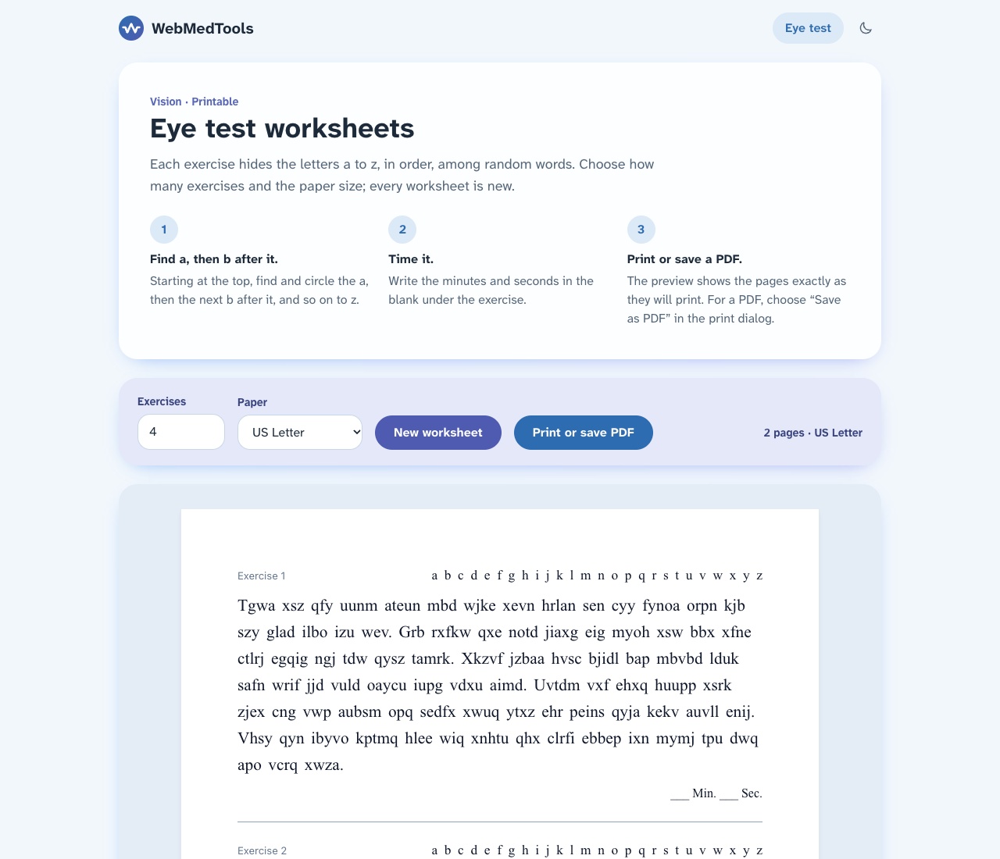

<h1 align="center">WebMedTools</h1>

<p align="center">
  Free printable worksheets for concussion rehabilitation.<br>
  <a href="https://webmedtools.com">webmedtools.com</a>
</p>

<picture>
  <source media="(prefers-color-scheme: dark)" srcset="docs/images/eye-test-dark.png">
  
</picture>

## What it is

Concussion rehab often includes eye-movement practice on paper: a page of random words with the letters a to z
hidden in order. You find the a, then the next b, and so on to z, and time yourself. The site makes a new sheet
whenever you need one, following the Michigan saccades eye test guidelines. Pick 1 to 100 exercises on US Letter or
A4, then print or save a PDF. The preview on screen is exactly what prints.

It's free, though it will carry ads in the future, and two practising doctors check each tool within their field
before it goes up. It started as a Java web app in 2023 and is being rebuilt to hold more tools.

This is not medical advice. These tools support exercises a clinician has recommended. Stop and talk to your 
clinician if symptoms get worse.

## What's next

Probably a letter-cancellation worksheet for attention practice, then an exercise done on screen, like a dot to
follow with your eyes. The open designs are in [docs/spec.md](docs/spec.md).

## How it's built

Next.js 16, TypeScript and Tailwind CSS 4, exported as static HTML and served by Cloudflare Workers. There's no
server or database: worksheets are generated in your browser and printed straight from it, with no PDF library.
Pages are in `app/`, and each tool's logic and tests are in `lib/`. [docs/architecture.md](docs/architecture.md) maps
the code, and the [decision records](docs/adr/README.md) explain why it's built this way.

To run it, you need Node 22.12 or later:

```sh
npm install
npm run dev      # http://localhost:3000
npm test
npm run build    # static site in out/
```

## How I work on it

I build it with [Sestina](https://github.com/warfalcon64/Sestina),
my workflow harness for [Claude Code](https://claude.com/claude-code). Before a print change ships, 
`npm run print-check` prints the worksheets in Chrome and Firefox on Letter and A4, and fails if any PDF differs
from its preview.

## License

[MIT](LICENSE)
